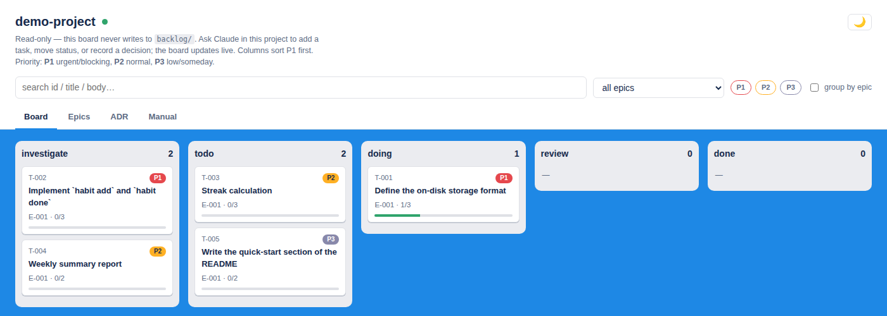

# backlog-board

**Keep epics, tasks and decisions as plain Markdown that Claude Code reads and writes
across sessions, with a live read-only board to see where everything stands.**

[](LICENSE)
[](https://github.com/JakubProgrammingWorkspace/backlog-board/actions/workflows/ci.yml)
[](https://www.python.org/)
[](https://docs.claude.com/en/docs/claude-code/plugins)
[](#design-notes)
[](#design-notes)

No MCP server, no database, no frontend build step. Just a Claude Code skill, one
stdlib-only Python script (`build.py`, copied into each project), and a small
stdlib-only Python HTTP server that ships with the plugin for the board itself.



*The board for the demo backlog in [`examples/demo-project`](examples/demo-project).*

## Quick start

```bash
/plugin marketplace add JakubProgrammingWorkspace/backlog-board
/plugin install backlog-board@backlog-board
```

Then, in your project, tell Claude: *"set up a backlog here and add an epic with tasks
for <your goal>"*. It creates `backlog/`, the epic and the task files, and runs
`build.py`. Open the board with `/backlog-board:backlog-board` (prints a
`http://127.0.0.1:3201/` URL). To see a populated board first, run the same command from
`examples/demo-project/`.

## Table of contents

- [Quick start](#quick-start)
- [Example workflow](#example-workflow)
- [Why](#why)
- [Install](#install)
- [Backlog format](#backlog-format)
- [The board](#the-board)
- [Session boundaries](#session-boundaries)
- [Configuration reference](#configuration-reference)
- [Regenerating INDEX.md](#regenerating-indexmd)
- [Requirements](#requirements)
- [Design notes](#design-notes)
- [Contributing](#contributing)
- [License](#license)

## Why

Agent-driven projects accumulate task state in ad-hoc places: a stale `plan.md`, a
giant hand-maintained "open issues" doc, a wishlist-flavoured `ADR.md` that never
records real decisions. This gives the agent (and you) one shared, git-committed
backlog instead: epics and tasks as markdown files with a small frontmatter contract,
a generated index the agent reads instead of scanning the directory, and a live
board for a human glance.

Deliberately not an MCP server — MCP tool schemas cost context on every turn whether
used or not. This is a skill: zero cost until triggered. The board server is a plain
local HTTP server started by the `SessionStart` hook or on request
(`/backlog-board:backlog-board`), not an always-on daemon, and it never accepts writes — tasks stay something Claude (or you) edit as files, never
something a UI mutates.

## Example workflow

How a piece of work flows across sessions. There is no dependency field: an
unfinished prerequisite is expressed with the `investigate` status plus a note naming it
(the status is defined as "something concrete and external is stopping otherwise-understood
work, e.g. another task"). The full backlog is in [`examples/demo-project`](examples/demo-project).

1. **Create the epic and tasks.** You ask Claude for a plan; it writes
   `backlog/epics/E-001-habit-tracker-cli.md` and one file per task, then runs
   `build.py`, which regenerates `INDEX.md`. A task looks like:

   ```markdown
   ---
   id: T-002
   title: Implement `habit add` and `habit done`
   epic: E-001
   status: investigate     # waiting on T-001
   priority: P1
   ---
   ## Context
   Blocked by T-001: the commands need `load()` / `save()`.
   ## Subtasks
   - [ ] `habit add <name>` creates a habit
   ```

2. **A session picks work.** Claude reads `INDEX.md`, takes a `todo` task, sets it
   `doing` (stamping `session_id:`), and works through the `## Subtasks`.
3. **It finishes.** Claude sets `review` (never `done` — that is the human's word),
   runs `build.py`, and offers a fresh session with a paste-ready `work T-0xx` line.
4. **You accept.** You set `status: done` and `completed:`, or leave it: after
   `review_after_days` of silence the board server promotes it to `done` itself.
5. **The blocker clears.** The next session moves T-002 from `investigate` to `todo`
   and picks it up. If a session stops mid-task, `/backlog-board:backlog-handoff` writes a
   continuation task so the next one starts cold with everything it needs.
6. **Housekeeping.** `done` items are deleted after `archive_after_days` (default 7
   working days) and the deletion is committed; git history keeps them.

## Install

```bash
/plugin marketplace add JakubProgrammingWorkspace/backlog-board
# or, from a local clone:
/plugin marketplace add ~/workspace/backlog-board
/plugin install backlog-board@backlog-board
```

Then, in each project you want it in, ask the agent to set up the backlog (or follow
`skills/backlog/reference/init.md` yourself):

```bash
mkdir -p backlog/epics backlog/tasks
cp "$CLAUDE_PLUGIN_ROOT/skills/backlog/build.py" backlog/build.py
python3 backlog/build.py
```

## Backlog format

```
backlog/
  INDEX.md            # generated — one row per task, "next free ID" line — committed
  build.py            # copied in at init and re-synced from the plugin on every session start, stdlib only — gitignored, not committed
  ADR.md              # append-only decision log — committed
  board.config.json   # optional, see Configuration reference — gitignored
  .gitignore          # generated — enforces "only .md files committed" below
  .board              # gitignored — written by the running board server (pid, port)
  .board-sessions     # gitignored — pids of the Claude sessions with this project open
  .board-nudge        # gitignored — last context-token count the context-nudge hook fired at
  epics/E-001-slug.md
  tasks/T-014-slug.md
```

**Only `.md` files under `backlog/` are ever committed** — everything else above is
excluded via `backlog/.gitignore`, generated automatically (both `build.py` and the
board server write/verify it on every run — no install step, nothing to remember, and
hand-editing it is pointless since it's overwritten back to the canonical content on
the next run). `build.py` itself is gitignored too, deliberately: the plugin is its one
canonical source, so a project doesn't carry a copy that can silently drift out of sync;
a fresh clone or CI machine without the plugin needs it re-copied (install the plugin,
rerun the `cp` from `reference/init.md`).

See `skills/backlog/reference/templates.md` for the exact frontmatter and body shape of
epics, tasks, and ADR entries. Task status is one of:

| Status | Meaning |
|---|---|
| `investigate` | Not yet actionable — scope depends on a decision, an investigation, a websearch, or something concrete and external is stopping otherwise-understood work (another task, a missing credential, a vendor fix). |
| `todo` | Understood and ready to pick up, just not started. `inprogress` is accepted as an alias and treated exactly like `todo`. |
| `doing` | Actively being worked. |
| `review` | The agent believes the work is finished; awaiting human acceptance. Auto-promotes to `done` after an idle window unless a human accepts (or rejects) it first. |
| `done` | A human has looked at the work and accepted it. |

### Renaming the data directory

If `backlog/` already means something else in a project (a queue, a metric, domain
data unrelated to this tracker), rename the data dir: put `{"dir": "your-name"}` in a
`.backlogrc.json` at the project root, before running `mkdir`. That file's name is
never itself configurable — it's the one fixed, predictable place `serve.py` checks to
find the (possibly renamed) data dir when walking up from an arbitrary cwd. `build.py`
doesn't need it: it's copied inside the data dir at init, so it always just operates on
its own containing folder regardless of what that's named. `.backlogrc.json` is
gitignored too (same policy) — the same generation mechanism appends one line for it to
the project's own root `.gitignore`, leaving everything else already in that file
untouched.

```json
{ "dir": "dev-tracker" }
```

`--dir NAME` on `serve.py` overrides it for a single invocation, same precedence shape
as the port option below (flag > config file > default).

## The board

```
/backlog-board:backlog-board
```

Starts (or reuses, if already running for this project) the plugin's board server and
prints its URL. It's `server/serve.py` — one file, stdlib only,
`http.server.ThreadingHTTPServer` — serving a vanilla JS/HTML/CSS frontend
(`server/static/`) that talks to it over `fetch` + Server-Sent Events. No build step,
no `node_modules`.

- **Live** — a background thread polls `backlog/`'s file mtimes; any change pushes an
  SSE event, the open board refetches and re-renders in place (filters, scroll
  position, and any open task drawer preserved).
- **Search** — client-side, over id/title/task body, plus epic and priority filters —
  fine at the scale a single project's backlog reaches; would move server-side well
  past ~1000 tasks.
- **Read-only, deliberately** — no write endpoints at all. Moving a card, checking a
  subtask box, editing a title — none of that happens in the UI. Tasks stay something
  the agent (or you) edit as files; the board only reflects them.
- **Automatic review acceptance** — every real startup (not a reuse), and again once
  per calendar day the server stays running, promotes `review` tasks idle for
  `review_after_days` (default 1 working day, weekends excluded, measured from
  `updated:` — a human editing the review notes buys another day) to `done`, stamping
  `completed:` itself. Turn it off with `review_auto_accept: false` to make `review` a
  hard human-only gate instead.
- **Automatic retention** — the same schedule as the sweep above deletes `done`
  tasks and epics older than `archive_after_days` (default 7 working days, weekends
  excluded), measured from `completed:` (an epic falls back to the latest `completed:`
  among its own tasks) and commits the deletion as `Backlog tasks update <date>`. A file is only deleted if it is tracked and
  clean, so it is always recoverable (`git log --diff-filter=D -- backlog/tasks/T-051-*`,
  then `git show <sha>^:<path>`). Ids are never reused — the committed `INDEX.md`
  `next:` line is the counter. Manual `build.py --archive` does the same, immediately.
- **Starts and stops with Claude Code** — the plugin installs both hooks, so there's
  nothing to wire up per project and nothing to remember. `SessionStart` runs
  `serve.py` (which also re-syncs `backlog/build.py` from the plugin); `SessionEnd` runs `serve.py --session-end`, which stops the server
  **only when the session leaving was the last one**. One board server is shared
  across every Claude session and terminal tab open on the same project, so each
  start registers its `CLAUDE_PID` in `backlog/.board-sessions` and each exit removes
  it — closing session A while B is still open leaves the board up for B. A session
  killed outright (`kill -9`, no `SessionEnd`) leaves a stale pid, which the next
  start or exit prunes by liveness check — but if that was the last session and
  nothing else starts or exits afterward, the board stays up until pruned; there's no
  idle self-reap. `/clear` fires `SessionEnd` too, and is deliberately exempt — it's
  immediately followed by a `SessionStart`, so stopping there would just flap the
  server. `serve.py --stop` remains the manual, unconditional "shut it down now" — it
  ignores the registry (and clears it), safe to run even if nothing is running.

If the port is already taken by something that isn't this project's own board server,
the launcher does **not** fall back to a random port — it prints a warning and exits
without starting anything. That warning surfaces through the `SessionStart` hook as a
normal Claude Code message, so you'll see it in-session rather than a server silently
coming up somewhere unexpected. Fix it by freeing the port, or pointing
`board.config.json`/`--port` at a different one.

## Session boundaries

Long sessions cost more and think worse, so the skill's working rule is one task per
session — full detail in "Session boundaries" in `skills/backlog/SKILL.md`.

- **On `review`**, the agent asks whether to start a fresh session (prints a paste-ready
  `work T-0xx` line for you to run after `/clear`), delegate the next task to a
  subagent (whose entire prompt is that task's file — no context re-explained), or
  keep going. Nothing here starts or clears a session itself; only you can.
- **`/backlog-board:backlog-handoff`** — for stopping mid-task rather than finishing one: writes a
  self-contained continuation task (state reached, `path:line`s, verify command,
  what's left) and prints the resume line.
- **Wide investigations** — before a broad read-only dig (multi-file grep, "what
  touches X", a websearch) the agent offers to hand it to a subagent and folds the
  answer back into the task's `## Context`. It asks first, and only when the read is
  wide and the answer small — a subagent cold-starts uncached, so it buys main-context
  lifetime, not lower total spend.
- **A `UserPromptSubmit` hook** (`serve.py --context-nudge`) reads the real context
  size straight from the transcript's token usage — not an estimate — and, once past
  `nudge_at_tokens` with a `doing` task on the current session, injects a one-line
  reminder naming it. Re-fires every `nudge_every_tokens` past that; silent below
  threshold or with nothing `doing`, so it costs nothing most of the time. The
  threshold never applies to an `investigate` task — an open investigation is
  legitimately token-heavy and open-ended, and shouldn't get nagged to wrap up.

## Configuration reference

All keys are optional, live in `backlog/board.config.json`, and are gitignored (commit
it yourself if the team should share settings):

| Key | Default | Meaning |
|---|---|---|
| `port` | `3201` | Board server port. Precedence: `--port` flag > this file > default. |
| `review_after_days` | `1` | Age in working days (from `updated:`, weekends excluded) after which a `review` task auto-promotes to `done`. |
| `review_auto_accept` | `true` | Turns the automatic review-acceptance sweep off — `review` becomes a hard human-only gate. |
| `auto_commit` | `true` | After the sweep deletes items, commit just those deletions as `Backlog tasks update <YYYY-MM-DD>`. |
| `archive_after_days` | `7` | Age in working days (from `completed:`, weekends excluded) after which the startup sweep deletes a `done` item (recoverable from git). |
| `archive_enabled` | `true` | Turns the automatic startup sweep off. Manual `build.py --archive` still works either way. |
| `nudge_at_tokens` | `120000` | Context size (real token count) at which the session-boundary nudge starts firing. |
| `nudge_every_tokens` | `25000` | How much further context has to grow before the nudge fires again. |
| `require_deferral_links` | `false` | When `true`, `build.py` refuses to build if a `done`/`review` task has an unchecked subtask that doesn't name a filed task id (`T-0xx`) — deferred work has to be filed as a follow-up, not just left as a note. |

```json
{
  "port": 3201,
  "review_after_days": 1,
  "review_auto_accept": true,
  "archive_after_days": 7,
  "archive_enabled": true,
  "nudge_at_tokens": 120000,
  "nudge_every_tokens": 25000,
  "require_deferral_links": false
}
```

## Regenerating INDEX.md

```bash
python3 backlog/build.py             # rebuild INDEX.md (validates ids, statuses, deferral gate)
python3 backlog/build.py --archive   # delete every done item now, then rebuild
python3 backlog/build.py --selftest  # run the inline self-checks
```

## Requirements

- Python 3.8+, standard library only — no `pip install` for either `build.py` or the
  board server.
- **Linux and macOS only** for the board server. `serve.py` daemonizes with
  `os.fork()`/`os.setsid()` and locks the session registry with `fcntl.flock` — both
  POSIX-only. On Windows the `SessionStart` hook doesn't start a board at all; the
  backlog skill itself (plain markdown + `build.py`) still works fine there.

## Design notes

- Frontmatter parsing is a small (~15-line) hand-rolled scalar parser, not YAML — every field
  in this format is a plain string, so a full parser would be dead dependency weight.
- Epic status is derived from its tasks, never set by hand, so it can't drift.
- The board server is plugin-only, never copied into the project (unlike `build.py`) —
  a clone without the plugin installed still has the raw `.md` files and `INDEX.md`,
  just no board.
- File watching is a 0.7s mtime poll, not `inotify` — one dependency-free `stat()`
  loop, plenty fast at backlog sizes this format is meant for.
- One vendored frontend file: `server/static/vendor/marked.min.js` (MIT licensed,
  https://github.com/markedjs/marked) — renders task/epic/ADR markdown bodies,
  including tables, in the drawer and ADR tab. Not npm `node_modules`-managed on
  purpose: it's a single static asset served alongside the rest of `server/static/`.

## Use in a real project

I built this to manage AI-agent work in a larger private project where tasks span many
Claude Code sessions. That is where the one-task-per-session rule, the `review` gate
and the handoff command came from.

## Contributing

Issues and pull requests are welcome. Run the checks locally with
`pip install pytest ruff`, then `python -m pytest` and `ruff check .`; CI runs the same
on Python 3.8 and 3.12. Keep it standard library only.

## License

MIT — see [LICENSE](LICENSE). The vendored `marked.min.js` (see Design notes) carries
its own MIT license from the upstream project.
